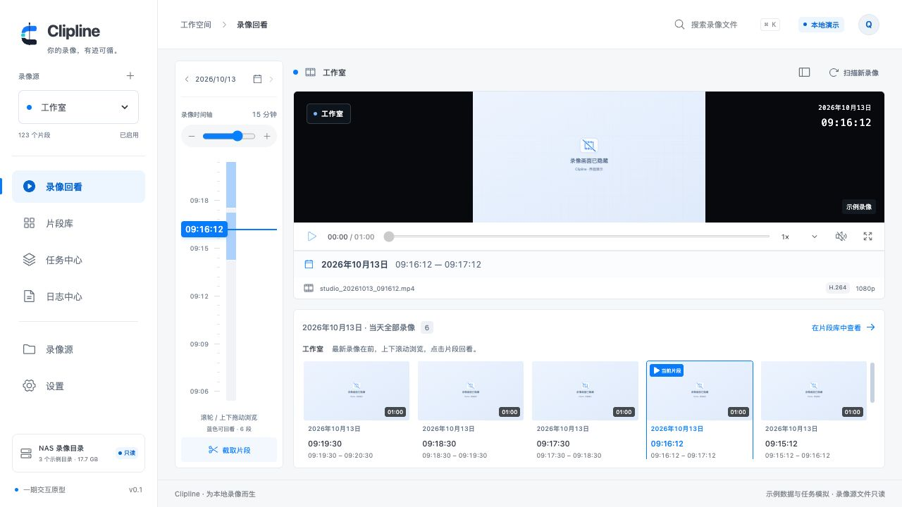
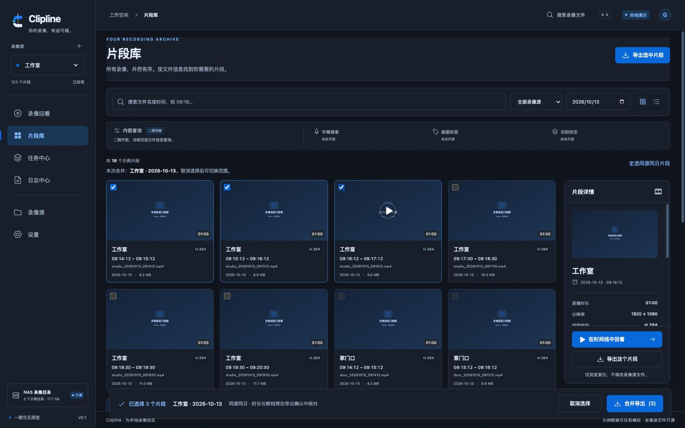
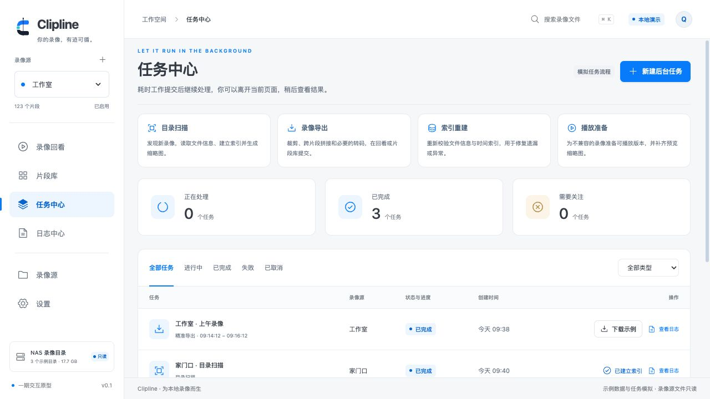
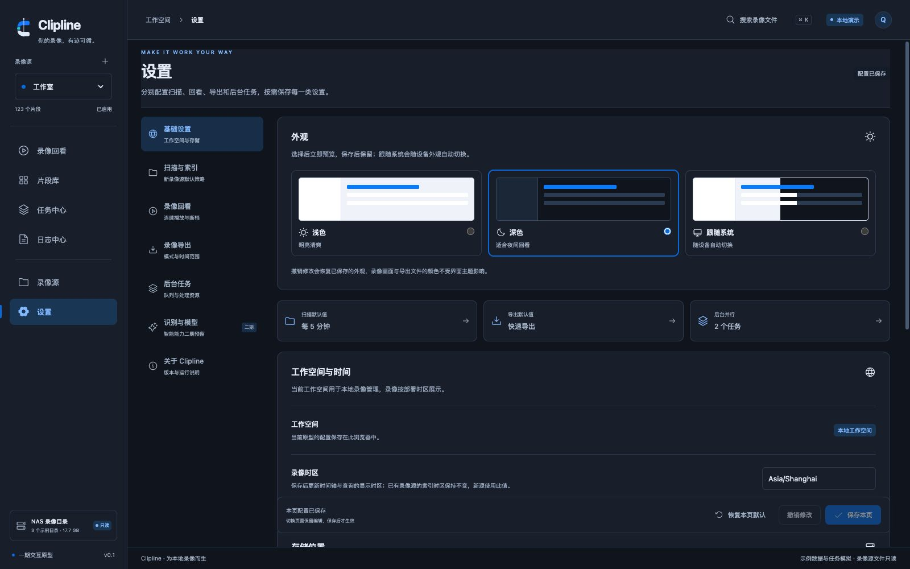

<p align="center">
  
</p>

<h1 align="center">Clipline</h1>

<p align="center">你的录像，有迹可循。</p>
<p align="center">部署在 NAS 上的本地录像工作台：按时间回看，选取区间，合并导出。</p>

<p align="center">
  <a href="https://github.com/HappyQuQu/clipline/actions/workflows/phase-one-checks.yml"></a>
  <a href="https://github.com/HappyQuQu/clipline/releases"></a>
  <a href="https://hub.docker.com/r/evanqu/clipline"></a>
  <a href="LICENSE"></a>
</p>

---

Clipline 把 NAS 中已有的录像文件整理成可检索、可回看的时间轴。选择录像源和日期，即可定位画面、查看片段详情，或将多个片段中的指定区间合并为一个视频。

采用蓝色主题和参考 UniFi 的竖向时间轴，支持浅色、深色与跟随系统外观，支持 **Linux amd64 / arm64**，通过一个 Docker 容器运行，无需单独部署数据库或消息队列。

**原录像只读。** 索引、缩略图、播放缓存和导出文件写入独立的应用数据目录；扫描、回看、导出和自动清理均不修改原录像。一期不包含语音转写或视频内容识别，相关入口保留二期占位，镜像不包含识别模型。

## 界面预览

以下均为深色模式演示界面，数据仅用于展示；播放器、录像缩略图及详情预览均已替换为占位图，不展示录像内容。

**录像回看 · 竖向时间轴与滑杆缩放**



**片段库 · 文件查询、片段详情与合并导出**



**任务中心 · 后台处理与结果下载**



**外观设置 · 浅色、深色与跟随系统**



## 能做什么

| 功能 | 使用方式 |
| --- | --- |
| 多录像源 | 添加已有录像目录，后台增量扫描；添加和编辑时检查重复目录及父子目录重叠 |
| 时间轴回看 | 滚轮滚动、拖动平移、滑杆缩放；标出有录像区间与断档，按有录像的日期定位 |
| 播放与详情 | 查看录像日期、起止时间、文件及编码信息；支持进度拖动、倍速和连续回看 |
| 兼容播放 | 浏览器支持时优先直读；不支持 H.265 时使用 H.264/AAC 边转边播，切换录像释放旧转码任务 |
| 片段库 | 按录像源、日期、文件名和时间查询，切换网格或列表；录像按最新在前排列 |
| 裁剪与合并 | 默认选取一分钟，拖动或输入起止时间；支持跨片段、跨天导出，单次跨度最大 **7 天** |
| 后台任务 | 扫描、重建索引、播放准备和导出在后台运行；查看进度、取消、重试及下载，支持重启恢复 |
| 日志与设置 | 日志筛选、详情及导出，诊断信息下载，分类保存设置；自动清理到期导出和临时文件 |

## Docker 快速部署

需要支持 Docker Compose V2 的 Linux NAS 或服务器。镜像会自动选择 `amd64` 或 `arm64` 架构。

### 1. 准备目录

准备两个独立目录：

- **录像目录**：已有录像所在位置，只读挂载。
- **应用数据目录**：保存 SQLite 数据库、缓存、导出结果和备份，需要可写。

两个目录不能互相嵌套。应用数据应放在 NAS 本地文件系统，避免将 SQLite 数据库放在 SMB/NFS 共享目录。

在独立部署文件夹内创建 `data` 目录，并将 `/path/to/recordings` 替换成自己的录像目录。`./data` 表示 `compose.yaml` 同级的应用数据目录。运行用户需对数据目录有读写权限，对录像目录有读取及目录访问权限；按 NAS 实际账号调整 `user`，无需修改原录像文件。

### 2. 创建 compose.yaml

```yaml
services:
  clipline:
    image: evanqu/clipline:latest
    user: "1000:1000"
    init: true
    restart: unless-stopped
    stop_grace_period: 15s
    ports:
      - "8088:8080"
    volumes:
      - ./data:/app/data
      - /path/to/recordings:/recordings:ro
    logging:
      driver: json-file
      options:
        max-size: "10m"
        max-file: "3"
```

`latest` 指向已通过双架构验收的正式镜像。需要控制升级时机时，可改为 [Releases](https://github.com/HappyQuQu/clipline/releases) 中的固定版本标签，如 `evanqu/clipline:0.11.0`，或固定镜像 digest。

### 3. 启动并添加录像源

在 `compose.yaml` 所在目录运行：

```bash
docker compose pull
docker compose up -d
docker compose ps
```

打开 `http://NAS地址:8088/`，在左侧 Logo 下添加录像源，选择**容器内路径**：

| NAS 上的实际位置 | 添加录像源时选择 |
| --- | --- |
| `/path/to/recordings` | `/recordings` |
| `/path/to/recordings/camera-01` | `/recordings/camera-01` |

添加后可立即发起后台扫描，在任务中心查看进度；索引完成后进入录像回看。支持扫描 MP4、MKV、MOV、TS 文件，实际播放与导出能力取决于文件内的编码及完整性。

应用面向可信局域网；需要外部访问时，通过带认证的反向代理接入。完整参数、部署预检和资源配置见 [部署说明](docs/DEPLOYMENT.md)。

## 回看与导出

1. 在左侧切换录像源，选择有录像的日期。
2. 滚动或拖动时间轴定位，使用滑杆调整时间尺度；也可直接点击下方录像缩略图。
3. 点击「管理片段」，默认选取一分钟，拖动边界或输入起止时间；跨天范围通过日期和时间选择器设置。
4. 预览实际录像时长和包含片段，选择导出模式，加入队列。
5. 在任务中心查看进度，完成后下载；等待期间可继续回看。

### 快速还是精准？

| 模式 | 处理方式 | 适用情况 |
| --- | --- | --- |
| **快速** | 保留原视频编码，音轨统一为 AAC，减少视频重编码 | 优先尝试，适合编码参数兼容的录像裁剪与合并 |
| **精准** | 视频重新编码为 H.264，音频使用 AAC | 需要精确边界、统一编码，或快速模式无法安全拼接时 |

快速模式已优化长关键帧场景，使用 MP4 编辑列表隐藏首段预滚画面；内部拼接边界仍受关键帧约束，可能产生少量偏差。编码参数不兼容或边界无法安全处理时，会提示改用精准模式。精准模式耗时取决于录像长度、分辨率和 NAS CPU 性能。

- **7 天按起止时间的总跨度计算，包含录像断档**；可在设置中降低上限。
- 断档和未选中的录像区间会跳过，导出结果连续拼接，不补黑画面。
- 片段库多选合并要求同一录像源、同一日期；**跨天导出从回看界面的区间选择发起**。
- 导出默认保留 **24 小时**，到期后在任务中心重新导出；清理不删除原录像。

浏览器不支持原编码时，首次播放或跳转到尚未转换的位置需要准备首批分片，耗时与设备性能有关。边转边播无需等待整段录像转换完成。

## 运行配置与维护

运行参数均在系统设置中保存，刷新或重启后保留，无需编辑 Docker 环境变量：

| 设置分类 | 可在界面修改 |
| --- | --- |
| 基础设置 | 外观（浅色 / 深色 / 跟随系统）、录像时区、业务日志保留天数、播放缓存容量 |
| 扫描与索引 | 新录像源默认扫描间隔、近期写入保护 |
| 录像回看 | 自动播放下一片段、自动跳过断档、兼容播放最大宽度 |
| 录像导出 | 默认导出模式、单次最长导出跨度、精准导出最大宽度、导出结果保留小时数 |
| 后台任务 | 队列并行任务数、媒体处理线程数、媒体处理并行上限 |

外观默认跟随系统，可在「设置 → 基础设置 → 外观」切换。选择后即时预览，保存后刷新或重启仍保留；撤销恢复已保存的外观。跟随系统会实时响应设备的深浅色变化，录像画面与导出文件保持原色。

默认录像时区为 `Asia/Shanghai`，媒体处理使用 2 线程、1 个媒体任务并行；兼容播放最大宽度 1920，精准导出最大宽度 3840。导出保留 24 小时，播放缓存上限 2 GiB，业务日志保留 30 天。

保存无需重启 Docker。线程数和导出保留期限对新开始的任务生效，输出宽度对新提交的导出计划或播放准备生效，已开始的任务保持原参数。缩减缓存容量或日志保留期限会在下一轮维护时清理超额应用数据，正在使用的文件受保护；已有导出的到期时间保持不变。修改显示时区不重写已有录像源的索引时区，新录像源使用新时区。

旧部署中的对应环境变量兼容为未保存配置的初始值，系统保存后以数据库设置为准。队列并行数限制整体任务数量，媒体并行上限单独限制媒体处理，两者共同生效。

与其他服务共用资源的小内存 NAS，可参考 [低资源部署档位](docs/DEPLOYMENT.md#2-gib共存其他服务的实测档位)，为容器设置 CPU/内存上限，并降低媒体线程数和转换分辨率。快速导出保留原视频，不受精准导出分辨率设置影响。

任务记录持久化到应用数据目录，容器重启后会恢复未完成工作；重试会创建新任务并保留原记录。自动清理保护正在播放、下载及处理中的应用文件。

升级前保存当前镜像版本，并执行数据库一致性备份。不要直接复制运行中的 SQLite 主文件作为完整备份；具体命令和恢复步骤见 [备份、升级与运维](docs/OPERATIONS.md)。

## 二期规划

以下功能**尚未实现**，当前仅预留界面与扩展位置：

- 语音转写、字幕与字幕搜索。
- 视频内容识别、画面标签与识别状态筛选。
- 片段详情中的识别结果及事件时间点。
- 录像源自动识别策略、识别后台任务与模型设置。

一期不会启动识别任务或下载模型，识别占位不影响扫描、回看和导出。

## 本地开发

前端使用 React + Vite，后端使用 Python + FastAPI，SQLite 保存索引和持久化任务，FFmpeg/FFprobe 负责媒体处理。生产镜像同时运行 API 与 Worker。

本地测试将自己的录像目录只读映射到 `/recordings`，应用数据独立放在 `data/local-test`。复制示例配置并替换录像路径；不要将应用数据写入原录像目录。以下命令在仓库根目录执行，需要 Docker、Node.js 24 LTS（当前固定 24.22.1，见 `.nvmrc`）及 npm；后端检查另需 uv。

使用 nvm 时先运行 `nvm install && nvm use`。CI 与 Docker 前端构建使用相同 Node 版本；最终运行镜像只包含 Python 服务和构建好的静态文件，NAS 无需另装 Node.js。

```bash
# 启动完整本地服务，访问 http://127.0.0.1:8088/
mkdir -p data/local-test
cp deploy/local-test.env.example data/local-test.env
# 编辑 data/local-test.env，将录像目录替换为自己的路径
CLIPLINE_UID=$(id -u) CLIPLINE_GID=$(id -g) \
  docker compose --env-file data/local-test.env up --build -d

# 可选：启动前端热更新，访问 http://127.0.0.1:5173/
npm ci --prefix frontend
npm run dev
```

Vite 将 `/api` 转发到本地 8088 服务。构建检查：

```bash
npm run build
```

开发服务器可显式通过 `?mode=demo` 查看交互原型；其中任务和导出为演示数据。正式 Docker 镜像关闭演示模式，不包含示例录像、旧版源码或模型。

## 文档与发布

| 文档 | 内容 |
| --- | --- |
| [部署说明](docs/DEPLOYMENT.md) | NAS 配置、部署预检、双架构验收与发布流程 |
| [运维说明](docs/OPERATIONS.md) | 保留策略、一致性备份、升级与恢复 |
| [需求文档](docs/REQUIREMENTS.md) | 产品范围、页面流程与验收要求 |
| [开发文档](docs/DEVELOPMENT.md) | 架构、接口、媒体处理及扩展设计 |
| [任务清单](docs/TASKS.md) | 开发里程碑与后续事项 |
| [后端说明](backend/README.md) | 本机开发、接口和验证脚本 |

应用版本见 [version.txt](version.txt)，版本变更见 [CHANGELOG.md](CHANGELOG.md)。`main` 检查通过后由 Release Please 管理版本，最终镜像分别通过 amd64、arm64 原生验收后发布并更新 `latest`；开发分支不发布正式镜像。

## 许可证

[MIT](LICENSE) · Copyright © 2026 EvanQu
