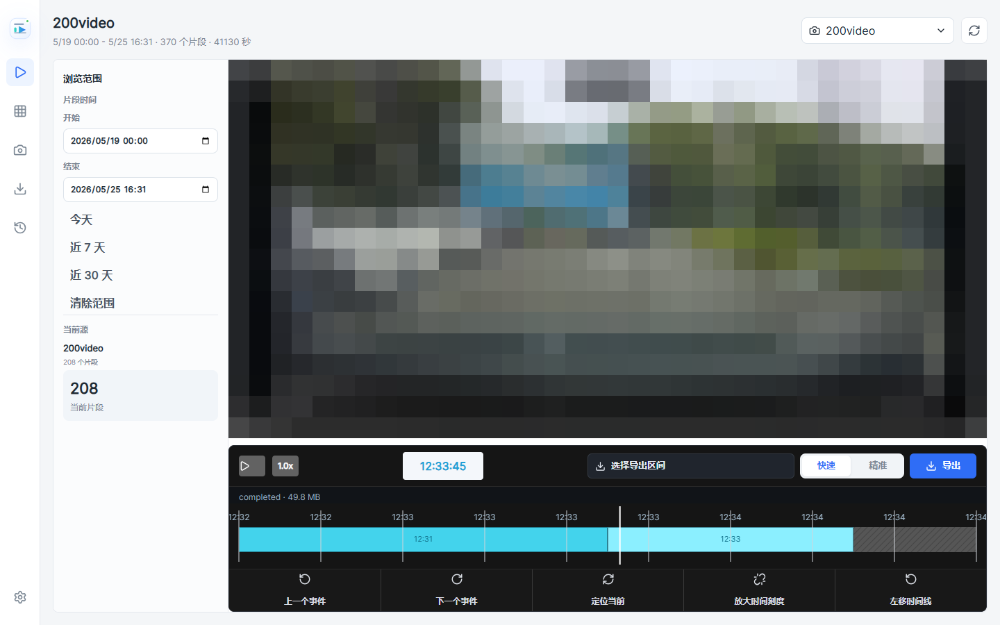
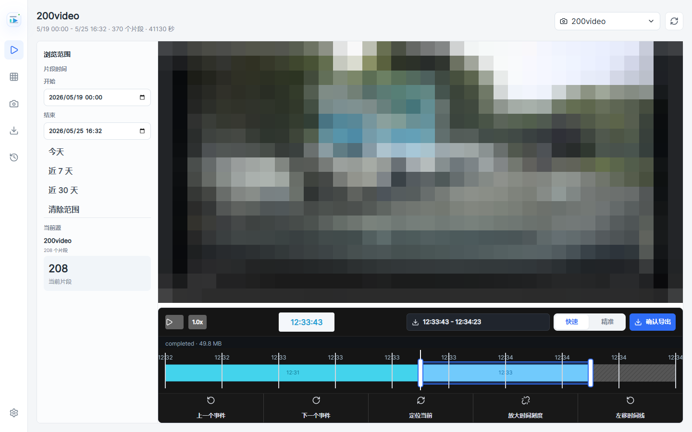
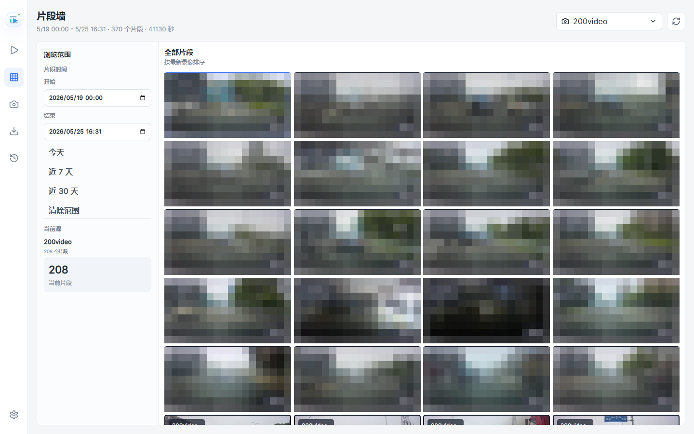
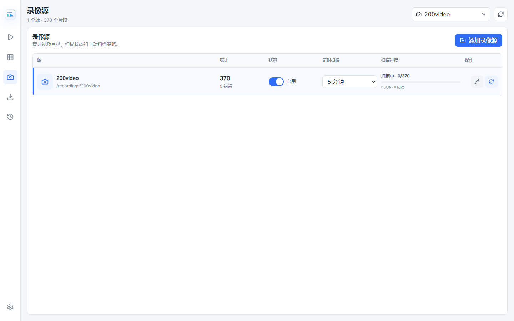

# Clipline

<p align="center">
  <a href="README.zh-CN.md">简体中文</a> · <strong>English</strong>
</p>

<p align="center">
  
</p>

<p align="center">
  <strong>A timeline workspace for scanning, replaying, searching, and exporting video segments backed up to a Xiaomi NAS.</strong>
</p>

<p align="center">
  <a href="https://hub.docker.com/r/evanqu/clipline"></a>
  <a href="LICENSE"></a>
  
</p>

Clipline organizes the continuously growing video segments stored on a Xiaomi NAS, home NAS, or local disk. It is designed for dashcams, surveillance cameras, parking monitors, body cameras, and other devices that save recordings as short time-based files.

Mount the recording directory and Clipline will scan the segments, build an index, generate thumbnails, and provide one place for replay, timeline navigation, full-text transcript search, and background export.

## Preview

| Playback and timeline | Range export |
| --- | --- |
|  |  |
| Segment library | Recording sources |
|  |  |

## Highlights

- Manage multiple NAS or local recording directories as independent sources.
- Scan new segments on a schedule while skipping files that are still being written.
- Browse recordings through a synchronized player and timeline.
- Generate thumbnails for quick recognition in the segment library.
- Export a selected time range in fast or precise mode without interrupting playback.
- Transcribe speech, search conversations, jump to matching timestamps, and export SRT or TXT subtitles.
- Track export, transcription, vision, and model-download progress from one task center.
- Run the React frontend, FastAPI backend, SQLite, FFmpeg, and media tooling in one container.

## Quick Start

Clipline requires Docker on Linux `amd64` or `arm64`. Prepare one writable directory for application data and one recording directory that can be mounted read-only.

```bash
docker run -d \
  --name clipline \
  --restart unless-stopped \
  -p 8080:8080 \
  -v /path/to/clipline-data:/app/data \
  -v /path/to/recordings:/recordings/xiaomi-nas:ro \
  -e TZ=Asia/Shanghai \
  evanqu/clipline:latest
```

Open `http://<server-address>:8080`, go to **Recording Sources**, and add the container path:

```text
/recordings/xiaomi-nas
```

Start a scan, then select the source from the playback workspace when indexing finishes.

## Docker Compose

Create a `compose.yaml` file:

```yaml
services:
  clipline:
    image: evanqu/clipline:latest
    container_name: clipline
    restart: unless-stopped
    ports:
      - "${CLIPLINE_HTTP_PORT:-8080}:8080"
    environment:
      TZ: ${TZ:-Asia/Shanghai}
      CLIPLINE_RECORDINGS_ROOT: /recordings
      CLIPLINE_SKIP_RECENT_SECONDS: ${CLIPLINE_SKIP_RECENT_SECONDS:-30}
      CLIPLINE_MAX_EXPORT_MINUTES: ${CLIPLINE_MAX_EXPORT_MINUTES:-30}
    volumes:
      - "${CLIPLINE_DATA_HOST:-./data}:/app/data"
      - "${CLIPLINE_RECORDINGS_HOST:-./recordings}:/recordings/xiaomi-nas:ro"
```

Start the service:

```bash
docker compose up -d
```

The repository also includes an editable [Docker Compose configuration](docker-compose.yml) for local source builds.

## Mounting a Xiaomi NAS Directory

### Linux or a NAS host

Mount the host directory directly:

```bash
docker run -d --name clipline --restart unless-stopped \
  -p 8080:8080 \
  -v /volume1/docker/clipline/data:/app/data \
  -v /volume1/backup/xiaomi-camera:/recordings/xiaomi-nas:ro \
  -e TZ=Asia/Shanghai \
  evanqu/clipline:latest
```

### Windows with Docker Desktop

Map the SMB share to a drive letter such as `Z:`, then mount that path into the container:

```powershell
docker run -d --name clipline --restart unless-stopped `
  -p 8080:8080 `
  -v "D:\clipline\data:/app/data" `
  -v "Z:\XiaomiNAS\CameraBackup:/recordings/xiaomi-nas:ro" `
  -e TZ=Asia/Shanghai `
  evanqu/clipline:latest
```

Paths configured in the UI are always container paths. Keep source recordings mounted read-only; Clipline stores its database, thumbnails, exports, playback proxies, and model cache under `/app/data`.

## Export Modes

| Mode | Behavior | Best for |
| --- | --- | --- |
| Fast | Avoids re-encoding where possible; boundaries may align to nearby keyframes. | Quick evidence capture, sharing, and longer ranges |
| Precise | Re-encodes for more accurate start and end boundaries. | Short ranges that require exact timing |

## Configuration

Clipline reads environment variables with the `CLIPLINE_` prefix.

| Variable | Default | Purpose |
| --- | --- | --- |
| `CLIPLINE_PORT` | `8080` | Backend listening port |
| `CLIPLINE_DATA` | `/app/data` | Application data directory |
| `CLIPLINE_DB` | `/app/data/clipline.db` | SQLite database path |
| `CLIPLINE_RECORDINGS_ROOT` | `/recordings` | Allowed recording root |
| `CLIPLINE_RECORDINGS_ROOTS` | Empty | Comma-separated recording roots |
| `CLIPLINE_SCAN_INTERVAL_SECONDS` | `300` | Scheduler scan interval |
| `CLIPLINE_SKIP_RECENT_SECONDS` | `30` | Ignore recently modified, potentially incomplete files |
| `CLIPLINE_MAX_EXPORT_MINUTES` | `30` | Maximum duration of one export |
| `CLIPLINE_MAX_CONCURRENT_EXPORTS` | `1` | Maximum concurrent exports |
| `CLIPLINE_EXPORT_TTL_HOURS` | `24` | Export retention period |
| `CLIPLINE_MODEL_CACHE_DIR` | `/app/data/models` | Speech and vision model cache |
| `CLIPLINE_ASR_MODEL` | `funasr` | ASR engine: `funasr`, `sensevoice`, or `whisper` |
| `CLIPLINE_ASR_MODEL_SIZE` | `base` | ASR model size |
| `CLIPLINE_ASR_DEVICE` | `auto` | Compute device: `auto`, `cpu`, `cuda`, or `mps` |
| `CLIPLINE_ASR_LANGUAGE` | `zh` | Recognition language: `zh`, `en`, or `mixed` |
| `CLIPLINE_ASR_AUTO_TRANSCRIBE` | `false` | Automatically transcribe new recordings |
| `CLIPLINE_PLAYBACK_PROXY_MAX_WIDTH` | `1920` | Maximum width of browser-compatible playback proxies |
| `CLIPLINE_PLAYBACK_PROXY_TIMEOUT_SECONDS` | `1800` | Initial playback proxy generation timeout |

See the [Simplified Chinese README](README.zh-CN.md#配置项) for the complete configuration table and model cache layout.

## Automatic Docker Hub Publishing

The [GitHub Actions workflow](.github/workflows/dockerhub.yml) builds and pushes `linux/amd64` and `linux/arm64` images when `main` or a `v*.*.*` tag is pushed. It also synchronizes [README.dockerhub.md](README.dockerhub.md) to the Docker Hub Overview.

Published tags include:

```text
evanqu/clipline:latest
evanqu/clipline:sha-<commit>
evanqu/clipline:<version>
```

Configure these GitHub Actions secrets:

| Secret | Required | Purpose |
| --- | --- | --- |
| `DOCKERHUB_USERNAME` | Yes | Docker Hub account name |
| `DOCKERHUB_TOKEN` | Yes | Push images and, as a fallback, update the Overview |
| `DOCKERHUB_DESCRIPTION_TOKEN` | No | Optional dedicated token for Overview updates |

The workflow can also be run manually with a custom image tag; the default manual tag is `edge`.

## Local Development

### Backend

```bash
cd backend
python -m venv .venv
source .venv/bin/activate
pip install -e ".[dev]"
uvicorn app.main:app --reload --host 127.0.0.1 --port 8080
```

Install `.[asr]` for speech recognition or `.[vision]` for ONNX-based video analysis.

### Frontend

```bash
cd frontend
npm install
npm run dev
```

The Vite development server runs at `http://127.0.0.1:5173` and proxies `/api` to `http://127.0.0.1:8080` by default. Set `VITE_API_TARGET` to use another backend address.

## Project Layout

```text
clipline/
├── backend/             # FastAPI API, scanning, export, scheduling, and database
├── frontend/            # React and Vite frontend
├── docs/                # Product, technical, API, and screenshot documentation
├── Dockerfile           # Multi-stage frontend and backend image
└── docker-compose.yml   # Local Compose configuration
```

## Technology

| Layer | Technology |
| --- | --- |
| Frontend | React 19, Vite, TypeScript, TanStack Query, Radix UI |
| Backend | FastAPI, SQLAlchemy, SQLite, Pydantic Settings |
| Media | FFmpeg and ffprobe |
| Speech recognition | FunASR, SenseVoice, and Whisper |
| Deployment | Single Docker container with the SPA served by FastAPI |

## Documentation and Support

- [简体中文项目说明](README.zh-CN.md)
- [API and database design](docs/API_AND_DB.md)
- [Issue tracker](https://github.com/HappyQuQu/clipline/issues)
- [License](LICENSE)

---

<p align="center"><strong>Turn scattered recording segments into a searchable, navigable, and exportable timeline.</strong></p>
