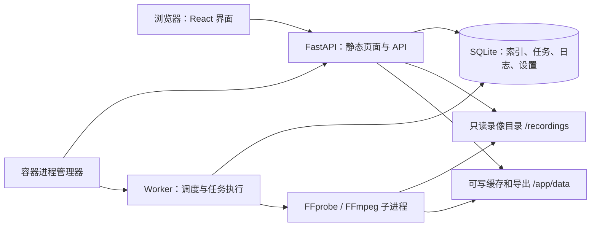

# Clipline 开发文档

版本：v1.0 · 日期：2026-10-13 · 状态：0.7.0 候选实现与验收记录

需求与验收依据：[方案与需求文档](REQUIREMENTS.md)；实施跟踪：[开发任务清单](TASKS.md)。当前前端边界见 [原型结构与二期接入](PROTOTYPE_ARCHITECTURE.md)。

本文中的目录、数据库、API、Docker 配置和测试为拟实现的正式版契约，除明确标注“已有”外均不代表已完成。

当前已完成 D1–D6，实际接口与部署方式见 [后端说明](../backend/README.md)，验证见 [D1](qa/D1_FOUNDATION.md)、[D2](qa/D2_INDEXING.md)、[D3](qa/D3_PLAYBACK.md)、[D4](qa/D4_EXPORTS.md)、[D5](qa/D5_OPERATIONS.md)及 [D6](qa/D6_ACCEPTANCE.md)。scan/reindex/prepare/export 已执行真实媒体工作，默认页面接通真实源、时间轴、回看、详情和片段库；真实裁剪、跨片段拼接和下载已接通，设置、日志、SSE、清理和备份已接入；原生 Linux 双架构与 x86 NAS 实测通过，发布采用候选门禁。本阶段以 `app.runtime` 作为进程管理器，API 和 Worker 分进程运行。

## 1. 架构与技术选择

一期采用单容器部署，内部 API 与 Worker 分进程。API 提供页面、查询和任务提交；Worker 独立领取持久化任务并调用 FFmpeg。浏览器不执行队列，不承担任务恢复。



| 层次 | 选择 | 说明 |
| --- | --- | --- |
| 前端 | React + Vite，沿用 `frontend/` | 当前 React 19、Vite 6；初期保留现有 JSX，API 契约使用明确类型 |
| API | Python 3.11 基线、FastAPI、Pydantic | 复用旧项目语言与领域经验，不整体复制旧启动逻辑 |
| 数据访问 | SQLAlchemy 2、SQLite WAL | 单机持久化；所有写事务保持短小 |
| 迁移 | Alembic | 版本化 schema，替代启动时零散 ALTER TABLE |
| 后台 | 独立 Python Worker + 数据库队列 | 一期不引入 Redis/Celery；未来可替换队列适配层 |
| 媒体 | FFprobe、FFmpeg | 解析参数、缩略图、播放代理、裁剪与拼接 |
| 运行 | Linux Docker，Supervisor 等进程管理器 | API/Worker 异常退出、子进程回收和健康状态受控 |
| 发布 | Buildx，多平台 manifest | `linux/amd64`、`linux/arm64`，同版本标签 |

依赖在实现时锁定并验证两种架构，本文不使用“最新版本”作为可重复构建的约束。一期包不得默认安装 Torch、FunASR、Whisper 或视觉模型运行库。

单容器是针对 NAS 安装便利性的取舍。Docker 通常建议按服务拆容器，也允许使用进程管理器运行多个进程；以后可把同一 Worker 拆为独立服务。参考 [Docker 多进程容器说明](https://docs.docker.com/engine/containers/multi-service_container/)。

## 2. 新代码组织

```text
clipline/
├── frontend/                     # 已有一期原型，逐步替换模拟数据
│   └── src/
│       ├── api/                  # 已有：HTTP、DTO、错误映射
│       ├── services/             # 拟新增：源、回看、任务等领域适配
│       ├── hooks/                # 播放状态、使用续租与 SSE
│       ├── pages/                # 已有：Review/Library/Tasks/Logs/Sources/Settings
│       └── capabilities.js       # 已有：二期能力及插槽
├── backend/                      # 已建立 D1–D5；old/backend 不直接作为运行目录
│   ├── app/
│   │   ├── main.py               # API 入口，不启动扫描循环或识别服务
│   │   ├── core/                 # 配置、路径约束、错误、时间规则
│   │   ├── api/                  # 请求/响应和路由
│   │   ├── db/                   # 模型、会话、仓储
│   │   ├── services/             # 扫描、时间轴、导出计划、播放缓存
│   │   ├── tasks/                # 类型注册、持久化、租约、状态迁移
│   │   └── worker.py             # 单一调度协调器与执行池
│   ├── migrations/
│   └── tests/
├── deploy/                       # 已有本地测试配置与 smoke 脚本；运行管理在 app.runtime
├── Dockerfile                    # 已实现 D1 双架构构建
├── compose.yaml                  # 已支持后台索引和真实回看
├── docs/
└── old/                          # 只读参考，不进入正式镜像
```

旧代码可参考扫描、时间解析、Range 播放和导出算法；提取代码时增加契约与回归测试。不得为了兼容旧实现而恢复一期识别依赖。

## 3. 部署与进程生命周期

### 3.1 持久化目录

| 路径 | 用途 | 约束 |
| --- | --- | --- |
| `/recordings` | NAS 录像根目录 | 只读挂载；子目录形成录像源 |
| `/app/data/clipline.db` | 索引、任务、设置和日志 | NAS 主机本地文件系统；不能放 SMB/NFS |
| `/app/data/thumbnails` | 缩略图 | 应用生成，可重建 |
| `/app/data/playback-proxies` | 浏览器兼容播放缓存 | 有容量上限、LRU 清理和使用保护 |
| `/app/data/exports` | 已完成导出 | 按到期时间清理 |
| `/app/data/tmp` | 任务临时文件 | 按任务和尝试隔离，不对外直接提供下载 |
| `/app/data/logs` | 详细程序输出 | 轮转；业务日志在数据库 |

SQLite WAL 依赖同机共享内存机制，不适合跨主机网络文件系统；本方案要求数据库及其 WAL/SHM 文件处于同一持久化本地目录。参考 [SQLite WAL 文档](https://www.sqlite.org/wal.html)。

以下是设计中的部署参数示例；实际配置以仓库 `compose.yaml` 为准，当前可执行 scan/reindex/prepare/export。NAS 主机目录先创建，并授予容器运行用户读写数据目录、读取录像目录的权限：

```yaml
services:
  clipline:
    image: evanqu/clipline:${CLIPLINE_IMAGE_TAG:?set-a-tested-version}
    restart: unless-stopped
    init: true
    ports:
      - "8080:8080"
    environment:
      TZ: Asia/Shanghai
      CLIPLINE_TIMEZONE: Asia/Shanghai
      CLIPLINE_DATA: /app/data
      CLIPLINE_DB: /app/data/clipline.db
      CLIPLINE_RECORDINGS_ROOT: /recordings
      CLIPLINE_MEDIA_THREADS: "2"
      CLIPLINE_MAX_CONCURRENT_TRANSCODES: "1"
      CLIPLINE_EXPORT_TTL_HOURS: "24"
      CLIPLINE_LOG_RETENTION_DAYS: "30"
      CLIPLINE_PLAYBACK_CACHE_MAX_BYTES: "2147483648"
    volumes:
      - type: bind
        source: ${CLIPLINE_DATA_DIR:?set-a-local-NAS-directory}
        target: /app/data
        bind:
          create_host_path: false
      - type: bind
        source: ${CLIPLINE_RECORDINGS_DIR:?set-the-recordings-directory}
        target: /recordings
        read_only: true
        bind:
          create_host_path: false
    healthcheck:
      test: ["CMD", "python", "-m", "app.healthcheck"]
      interval: 30s
      timeout: 5s
      start_period: 30s
      retries: 3
```

不固定 `platform`，由镜像 manifest 选择主机架构。更多录像根目录可通过明确的只读挂载与服务端根目录白名单扩展，不默认允许容器 `/`。

#### 本地测试指定映射

用户指定宿主机目录为 `/Volumes/extended/clipline`。本机已确认它存在且可读，包含 `media` 及旧数据库、设置和缓存。正式版本地测试沿用此目录作为只读输入，不在其中新建数据库、写缓存或导出结果，也不导入覆盖旧库。

本地映射配置固定如下；D1 运行配置已保存于 `deploy/local-test.env.example`，采用 `clipline:d1-local` 和独立的 8088 端口：

```dotenv
CLIPLINE_RECORDINGS_DIR=/Volumes/extended/clipline
CLIPLINE_DATA_DIR=/Users/qu/Documents/GitHub/clipline/data/local-test
CLIPLINE_IMAGE_TAG=d1-local
```

容器内映射为 `/recordings:ro` 与 `/app/data:rw`；在录像源表单选择 `/recordings/media` 下的实际录像目录，避免把根目录中的旧导出和代理当成原录像扫描。启动前创建独立的 `data/local-test` 并验证容器访问权限；该目录已被 `.gitignore` 的 `data/` 规则排除。

合成测试样本写入另外的临时目录/卷，以覆盖损坏、跨日、重叠等边界，不改变此真实录像目录。D1 已验证 Docker 挂载与真实样本探测/首帧解码；完整媒体流程及原生 x86 NAS 验收仍待完成。

### 3.2 启动、健康与停止

1. 启动脚本校验配置、挂载权限、可写空间和 FFmpeg 可用性。
2. 获取启动互斥锁，检查数据库版本，使用 SQLite 备份接口备份后执行迁移；失败则退出，不启动 API/Worker。
3. 进程管理器启动一个 API 进程和一个 Worker 协调器；初期 API 不开多个进程，不使用开发 reload。
4. Worker 取得工作空间协调器锁，恢复过期租约和未完成任务，再开启扫描调度与执行池。
5. `/api/health/live` 检查 API 存活；`/api/health/ready` 检查迁移版本、DB 与 Worker 心跳。录像源离线属于业务异常，不直接使服务健康失败。
6. 关键进程反复退出时，进程管理器退出整个容器，让 Docker 重启。仅标记 unhealthy 不会自动触发 `restart` 策略，需要实现上述退出行为。
7. 收到停止信号后停止领任务，给运行任务有限时间收尾；终止剩余 FFmpeg 进程组，释放租约，再退出。

所有 FFmpeg 子进程归属可回收的进程组；异常恢复前先确认旧执行器已退出。禁止仅凭 PID 数字判断任务仍属于当前实例。

## 4. 数据模型

### 4.1 通用约定

- 实体使用 UUID 字符串；时间字段在 DB 中采用 UTC epoch 毫秒，在 API 中使用带 `Z` 的 ISO 8601。
- 录像区间统一为半开区间 `[startAt, endAt)`；时长、偏移使用毫秒，文件大小使用整数 byte。
- JSON 使用 camelCase，DB 使用 snake_case；前端通过适配层转换，不能把原型的“当天秒数”直接存入正式数据库。
- SQLite 开启外键、WAL，建议使用 `synchronous=FULL` 并设置 busy timeout（建议 5 秒）；一个线程/任务一个会话，FFmpeg 运行期间不持有 DB 写事务。
- 设置值存储为真实数字/布尔类型，不照搬原型的字符串数值。

### 4.2 核心表

| 表 | 核心字段 | 关键约束 / 索引 |
| --- | --- | --- |
| `sources` | id, name, canonical_path, enabled, scan_interval_minutes, recording_timezone, auto_transcribe, auto_detect, last_scan_at, next_scan_at, created_at, updated_at, revision | canonical_path 唯一；manual 用 null；识别字段 false；revision 仅配置变化递增 |
| `segments` | id, source_id, relative_path, filename, size_bytes, mtime_ns, fingerprint, start_at, end_at, duration_ms, time_source, time_confidence, container, video_codec, audio_codec, width, height, fps_num/fps_den, availability, playback_status, error_code, index_revision, last_seen_scan | unique(source_id, relative_path)；索引(source_id, start_at)、(source_id, end_at)；duration > 0；last_seen_scan 保存逻辑任务 ID |
| `tasks` | id, kind, source_id, payload_json, status, stage, progress, result_json, error_code, error_message, retry_of_task_id, attempt_no, recovery_count, idempotency_key, active_key, available_at, lease_owner, lease_token, lease_until, cancel_requested_at, created_at, started_at, finished_at | active_key 非空时唯一；队列索引(status, available_at, created_at) |
| `task_requests` | scope, request_key, request_hash, response_json, task_id, created_at | 联合主键(scope, request_key)；活动工作复用的请求别名也持久化；参数不同返回冲突 |
| `task_attempts` | id, task_id, attempt_no, lease_token, status, started_at, finished_at, checkpoint_json, error_code | unique(task_id, attempt_no)；保留中断历史 |
| `artifacts` | id, task_id, segment_id, kind, relative_path, profile_hash, input_fingerprint, size_bytes, duration_ms, status, expires_at, last_access_at | 文件仅位于 data 内；下载必须检查完成状态与有效期 |
| `business_logs` | id, created_at, level, kind, source_id, task_id, event_code, title, detail_json | 索引(created_at, id)、(task_id, created_at)、(source_id, created_at) |
| `settings` | group_name, value_json, revision, updated_at | group_name 唯一；分类版本用于并发保存 |
| `runtime_leases` | resource_key, owner, token, expires_at | 单协调器、源索引锁与媒体资源租约 |
| `events` | id, event_type, entity_id, payload_json, created_at | 单调递增 ID；用于任务变化订阅和断线恢复 |

`availability` 至少区分 available、pending、missing、unreadable、invalid；`playback_status` 区分 direct、needs_prepare、preparing、ready、failed。任务成功只表示执行过程完成，逐文件失败数量必须单独返回。D2 迁移为 `0003_indexing_queue`，升版本前继续使用 D1 的一致性备份策略。

源目录在存在索引后锁定；名称、频率和启停可编辑。已有索引的目录变更请求返回 `SOURCE_PATH_LOCKED`，前端提示添加新源。原型可以编辑路径，接正式版时需补这个校验和提示。

本方案不提供自动导入旧数据库。优先从目录重新扫描建立新索引；旧数据迁移若有需要，另做离线转换工具，备份原库并验证时间、模式枚举及识别字段映射。

## 5. API 契约

统一前缀 `/api`。列表默认 50、最多 200 项，稳定排序并使用游标；响应采用 `{ items, nextCursor }`。错误采用：

```json
{
  "error": {
    "code": "SOURCE_PATH_OUTSIDE_ROOT",
    "message": "请选择允许录像目录内的文件夹。",
    "details": { "field": "path" },
    "requestId": "req_example"
  }
}
```

校验错误 422、不存在 404、状态或资源冲突 409；未就绪的媒体明确返回状态，不伪造空视频。前端显示可理解的 message，日志保留 code 与 requestId。

### 5.1 录像源与文件

| 方法与路径 | 请求 / 查询 | 返回与行为 |
| --- | --- | --- |
| GET `/recording-directories` | rootId, relativePath, cursor | 根目录白名单内的分页子目录；不允许任意 absolute root 参数 |
| GET `/sources` | — | 源及最近扫描摘要 |
| POST `/sources` | name, path, scanIntervalMinutes, scanOnCreate | 201 `{source, firstTaskId}`；源与首次扫描任务同一事务创建 |
| PATCH `/sources/{id}` | name, enabled, scanIntervalMinutes；允许条件下 path | 返回更新源；校验路径锁与版本 |
| POST `/sources/{id}/scan` | 空对象；请求带幂等键 | 202 `{taskId, reused}`；同源活动扫描复用 |
| GET `/segments` | sourceId, date, q, viewTimezone, cursor | 源/日期/文件名与起止时刻文本匹配；date 使用日区间重叠查询；回看时间窗由 timeline 接口提供 |
| GET `/segments/{id}` | — | 完整元数据、文件与播放状态 |
| GET `/sources/{id}/dates` | viewTimezone | 有录像的本地日期，跨日片段出现在重叠日期 |
| GET `/timeline` | sourceId, date, viewTimezone, startSeconds, endSeconds, cursor, limit | 当日录像覆盖、断档及按需加载的片段索引；覆盖合并，片段不丢失 |
| GET `/sources/{id}/resolve` | at（含时区的 ISO 时间） | 对应片段与 offsetMs；无覆盖时返回 gap 与下一片段信息 |
| GET `/segments/{id}/thumbnail` | — | 已有缩略图；未生成时返回可识别的占位状态 |
| GET `/segments/{id}/playback` | — | `{status, mediaUrl, taskId, proxy}`；未准备不触发同步转码 |
| POST `/segments/{id}/prepare` | mode=compatible/hevc/original/stream + startMs（默认 compatible），可 force=true；profile 由服务端生成 | 202，创建或复用播放准备任务 |
| GET/HEAD `/segments/{id}/media` | fingerprint、HTTP Range/If-Range/ETag | 原文件或已完成代理的字节流；206、416 等范围行为正确 |

定位路由使用 `/sources/{id}/resolve`，避免片段 ID 与静态定位路径冲突。所有源和片段路径由 ID 在服务端解析，客户端不能指定任意文件作为 stream 输入。

### 5.2 任务、导出与日志

| 方法与路径 | 请求 / 查询 | 返回与行为 |
| --- | --- | --- |
| POST `/tasks` | kind=scan/reindex/prepare, sourceId, kind 对应 payload | 202 `{taskId, reused}`；export 走专用校验入口 |
| GET `/tasks` | status, kind, sourceId, cursor | 持久化任务列表；active 包含 queued/running/cancelling |
| GET `/tasks/{id}` | — | 状态、阶段、进度、尝试和关联结果 |
| POST `/tasks/{id}/cancel` | — | 返回实际状态；运行任务先进入 cancelling；重复取消幂等 |
| POST `/tasks/{id}/retry` | 可选 mode=precise | 202 新任务 ID，retryOfTaskId 指向原任务；重新校验源文件 |
| POST `/exports/plan` | 与提交相同的参数 | 预览覆盖、断档、未选中时长、片段数及 planHash |
| POST `/exports/{taskId}/resubmit` | Idempotency-Key | 完成结果新 ID 重导出，保留原记录；输入变化须重新选区间 |
| POST `/exports` | sourceId, startAt, endAt, date?, viewTimezone?, segmentIds?, mode, name?, planHash? | 202 统一 export taskId，参数快照入库 |
| GET `/exports/{taskId}/download` | HTTP Range，可选 | 下载完成且未过期的结果；未完成 409，过期 410 |
| GET `/logs` | level, kind, sourceId, taskId, q, cursor | 筛选业务日志 |
| GET `/logs/export` | 与列表相同筛选 | JSON 下载；固定查询快照，遍历全部匹配项，不能只导出当前页 |
| GET `/system/diagnostics` | — | 有边界的诊断 JSON；大型日志通过日志导出另取 |
| GET `/events` | sinceEventId / Last-Event-ID | SSE 变化通知，断线后恢复；过期游标通知重新拉取快照 |

后台创建请求带 `Idempotency-Key`。同一键和相同规范化请求返回原任务；同一键但不同参数返回 409。可重复的用户操作应生成新键；点击重试也使用新键。

export payload 示例：

```json
{
  "sourceId": "src_example",
  "startAt": "2026-10-13T01:14:12.000Z",
  "endAt": "2026-10-13T01:20:30.000Z",
  "mode": "precise",
  "segmentIds": ["seg_01", "seg_02", "seg_03"]
}
```

以上对应北京时间 09:14:12–09:20:30。不传 segmentIds 时使用区间内全部可用片段；传入时只使用所选 ID，必须同源、覆盖范围有效且属于允许日期。服务端按片段实际信息重算计划，不信任客户端传入的时长或文件路径。

### 5.3 设置与能力

| 方法与路径 | 行为 |
| --- | --- |
| GET `/settings` | 返回各分类已保存值和 revision；同时返回只读部署信息 |
| PATCH `/settings/{group}` | `{revision, values}`；仅允许该分类字段，冲突返回 409 |
| GET `/capabilities` | 返回基础能力、关闭的识别能力、受支持导出模式和运行架构 |
| GET `/system/status` | 版本、arch、Worker、队列、磁盘、FFmpeg 和缓存统计 |
| GET `/health/live`、`/health/ready` | 进程与依赖就绪状态 |

`scan`、`playback`、`export`、`tasks` 为可编辑分类，PATCH body 为 `{revision, values}`，values 包含本分类的完整字段。默认间隔可为 null（仅手动）；maxDuration 仅允许 10/30/60，concurrency 仅允许 1/2/3。路径、硬件信息和一期识别能力只读。服务端拒绝一期识别任务及策略启用请求，不能依靠前端隐藏按钮保证范围。

## 6. 扫描、时间与回看实现

### 6.1 路径与扫描

1. 根目录从部署配置生成白名单，目录浏览使用 rootId + 相对路径。
2. 拒绝控制字符、目录穿越和未知根；真实路径解析后检查包含关系，符号链接不能越界。检查目录存在及访问权限。
3. duplicate 检查使用规范化真实目录；文件探测前再次验证范围与文件状态。禁止把旧版默认 `/` 根直接沿用。
4. FFprobe 通过参数数组启动，禁用 shell；只输入已校验本地普通文件，设置进程超时与输出大小限制。
5. 扫描开始记录 runId，分批 UPSERT；文件指纹至少包含源、相对路径、大小和纳秒修改时间。
6. 近期更新文件延后处理；探测前后 stat 不一致则认定仍在变化，延后重试。
7. 单文件失败写文件状态及日志，任务返回成功/失败/跳过统计；权限错误导致目录无法完成遍历时标为扫描失败。
8. 只有完整、成功的目录遍历才能对未发现文件标记 missing；部分扫描或目录离线不改变既有可用状态。missing 不删除元数据。
9. 源内 scan 与 reindex 互斥；缩略图作为阶段处理，不为每张图创建顶层任务。

停用源后停止创建新维护任务并取消尚未开始的维护任务；已运行任务可收尾，用户也可手动取消。历史回看和导出不以 enabled=true 为条件，只校验文件可读与路径边界。

### 6.2 录像时间

- 支持可识别的 `YYYYMMDD_HHMMSS`、`YYYY-MM-DD_HH-MM-SS` 等规则，并明确每种规则的解释方式；目录时间规则单独配置解析器。
- 文件名/目录时间按 source.recordingTimezone 解释，转换为 UTC 存储；不使用 NAS 进程所在时区隐式解析。
- 无可解析开始时间时使用文件修改时间减时长等回退策略，标记 `timeSource` 和置信度；mtime 不能被描述为确定录像时间。
- 无效日期或时长不会让整个扫描崩溃；失败文件记录原因。
- 日期查询先把本地日期转成 UTC `[dayStart, nextDayStart)`，使用 `segment.start < dayEnd AND segment.end > dayStart`。
- 日期转换使用时区库生成次日本地零点，不硬编码所有日期都为 86400 秒；默认上海时区，但数据契约保留完整时区含义。

时间轴覆盖取区间并集，片段条保留每个原文件。多个文件同时覆盖定位点时，按最早开始时间、片段 ID 的稳定顺序选择；自动续播跳过已经覆盖的重复部分。

### 6.3 真实播放与兼容准备

浏览器支持的容器/编码直接提供 Range 流，客户端根据实际播放失败或媒体能力检测决定是否需要 prepare，不能仅因 H.264 标签就保证所有浏览器都可播放。

前端对 H.265 按实际 `canPlayType` 能力选择 `mode`：支持视频和原音轨时使用 `original` Range 直读（不排队、不生成缓存）；支持 H.265/AAC 但不支持原音轨时用 `hevc`，仅流复制视频、转 AAC，并写 hvc1/faststart MP4。服务端只允许符合索引容器和音轨条件的 H.265 文件走原片路径，仍检查路径、指纹和大小/mtime。若浏览器解码失败，自动按 original → hevc → stream 回退，保留定位和播放意图，不循环重试。状态、媒体和视图租约携带同一个 mode；不同输出 profile 的缓存并存，仍受统一容量、任务取消/恢复和原子发布约束。旧客户端不传 mode，保持原有 H.264 路径。

不支持 H.265 的浏览器默认选择 `stream`，按 `startMs` 对齐 4 秒创建 H.264/AAC HLS 任务。Worker 单次连续编码，分片经完整写入、FFprobe 校验后逐个原子发布；首片就绪即返回 EVENT 播放列表，任务仍可运行。每个 TS 是独立、不可变的 Artifact，继续沿用 Range、文件锁、容量/LRU 和使用保护。GET 播放列表和分片不执行转码。

检查点与分片记录在同一数据库事务中提交，重启从最后一个已提交分片末尾继续编码，播放列表 URL 保持不变，恢复边界插入 discontinuity。切换到未转换位置会新建该位置的流式任务；浏览器通过 20 秒观看租约维持需求，最后一个观看者离开即停止旧任务。任务中心显式重试属于后台缓存准备，可在无观看者时继续；重试生成新 ID。取消/失败留下的已生成分片按正常使用租约和维护策略清理，原录像不参与清理。

流式接口：GET `/segments/{id}/hls/{taskId}/index.m3u8`、GET/HEAD `/{artifactId}.ts`，均校验原片指纹；POST `/segments/{id}/hls/{taskId}/lease` 接收 clientId/active。默认兼容 MP4 缓存可优先复用。播放器以原录像完整时长显示进度，将流式起点偏移映射回原片时间；拖动中只预览滑块位置，松开后提交一次定位，避免中间位置开始准备导致滑块提前禁用。未转换位置直接定位到新位置生成首片，不等待前面的内容转换完成。网络中断保留播放器并重连，解码失败显示重试入口。首片准备时间受源录像关键帧间隔和设备解码能力影响。

非零偏移（含重启续播）先将原片的音视频包复制到当前执行尝试的临时 Matroska 中重建定位索引，再从目标位置编码 HLS。部分相机 MP4 的定位表会把 240 秒请求落到约 42 秒，重建可避免从过早位置解码追赶；该步骤不转码、不修改原片，仍在同一媒体并行槽和线程限制中执行。重建前校验可用空间，输出有大小上限并核对完整时长；取消、失败或完成都会删除临时索引文件。

录像回看的当前日期、片段列表标题、缩略图均显示完整年月日。跨日源片额外展示起止日期；播放器日期按原片 UTC 时间、当前偏移和显示时区计算，不从截图或水印识别。

播放代理默认采用 MP4 + H.264，存在音轨时转 AAC，无音轨不补音频；使用适合 HTTP 播放的封装。建议默认限制代理宽度为 1920，低性能设备允许通过部署配置调低，不改变原文件。

缓存键包含片段指纹、输出 profile、实现版本；已失效的代理不复用。同一键的 prepare 任务去重，输出临时文件验证成功后原子发布。生成过程只在 Worker，GET stream 不执行转码。

播放器状态包含 sourceId、日期、segmentId 和定位 offsetMs。切换上下文取消旧 HTTP 请求、重建 video 元素；metadata 就绪后设置偏移，避免旧请求或共用 URL 导致位置错乱。跨源切换不继承旧详情或截取区间；自动续播可保留用户正在编辑的同源截取区间。

## 7. 导出计划与执行

### 7.1 计划生成

对请求 `[a,b)` 先验证同源同日、`b>a`、跨度上限和可读文件。选中集合 S 为显式 segmentIds；未指定时取全部有效片段。

```text
recordedCoverage = union(全部可用片段与 [a,b) 的交集)
selectedCoverage = union(S 中片段与 [a,b) 的交集)
unrecordedMs     = (b-a) - length(recordedCoverage)
omittedMs        = length(recordedCoverage) - length(selectedCoverage)
outputTargetMs  = length(selectedCoverage)
```

先按 startAt、id 稳定排序，通过游标去除重叠部分，生成每个输入文件的 offsetStartMs/offsetEndMs。无 selectedCoverage 则拒绝；不将断档或未选中区间补入输出。

提交时保存计划摘要、源目录、UTC 时间、输入指纹及输出 profile；前端带 planHash 复核预览和提交一致性。执行及发布时重新校验，文件变化则失败为 `INPUT_CHANGED`，不能继续使用过期偏移静默生成错误录像。

### 7.2 模式与结果

| 项目 | fast | precise |
| --- | --- | --- |
| 处理 | 尽可能 stream copy，检查各输入参数兼容性 | 解码、按目标区间截取、统一参数、重新编码 |
| 边界 | 受关键帧和封装影响，可能有偏差 | 视频目标误差不超过一个输出帧，音频考虑编码填充 |
| 不兼容 | 返回清晰原因，提供精准重试 | 支持可解码格式，异常明确失败 |
| 资源 | 主要为读取和封装；仍受总任务限额 | 占用唯一重型转码资源槽 |

D4 的 fast 单片段实际时长偏差大于 5 秒时返回 `FAST_BOUNDARY_UNSAFE`，参数不一致返回 `FAST_INCOMPATIBLE`；均可显式精准重试。普通重试保留模式，新任务 ID 关联原任务，不能在输入变化后静默重算计划。

precise 使用默认 25 fps（配置范围 1–60）、最大宽度 3840 的等比例 H.264 输出。按累计时长四舍五入分配各片段帧数，避免每段舍入累积误差。顺序生成 NUT/PCM 中间文件，用明确帧时长拼接，最终只编码一次 AAC；有声和无声混合时补静音，全无音轨不建音轨。校验输出帧数、逐包连续时间戳、音轨时长和起点（AAC 填充容差 50 ms），并完整解码精准结果。

一期统一 mode 为 `fast | precise`；旧后端使用 `accurate`，如提取旧服务代码需显式转换。旧版 timelapse 不属于一期契约。

FFmpeg 通过进程调用并解析 `-progress`，百分比以预期媒体处理时长估算，阶段切换另有明确名称。完成后 FFprobe 检查容器、音视频轨、时间戳与实际时长，保存 expected/actual duration。精度验证不能只依赖命令退出码或完整秒数。

结果写入 task/attempt 暂存目录；验证后 fsync 文件和 manifest（计划 hash、结果 SHA256/大小/媒体参数、路径），终态事务复核所有权、取消和输入后原子发布，DB 同事务记录 completed 与 artifact。若重命名后数据库提交前崩溃，恢复时按 manifest 对账 SHA256 和计划，可复用已验证结果；不开放未登记文件。导出 TTL 在发布时固定，D4 下载接口执行过期检查，D5 已接入受使用保护的物理清理。下载接口只访问已登记结果，不把 tmp 或 exports 整目录作为静态文件公开。参考 [FFmpeg 官方文档](https://ffmpeg.org/ffmpeg.html)。

## 8. 持久化任务与恢复

### 8.1 状态和重试

```text
queued -> running -> completed
                  -> failed
queued -> cancelled
running -> cancelling -> cancelled
failed/cancelled -> 用户重试生成新 task，retryOfTaskId 指向原 task
running/cancelling -> 异常中断后由恢复流程处理
```

任务执行过程重启重试仍保留同一逻辑 taskId，但增加 attemptNo；用户主动重试创建新 taskId。原型同 ID 重试需在 API 适配时改为这一契约。

阶段与统计由执行器报告，不按照固定计时器虚构。无法预估总量的扫描阶段允许显示“已发现/已处理文件数”而非不准确的百分比。

### 8.2 领取、租约与去重

1. 单 Worker 协调器持有本地进程锁与 DB 租约，负责定时扫描和资源分配，避免 API 多次启动造成重复调度。
2. 在短 `BEGIN IMMEDIATE` 事务中领取到期 queued 任务，取得源互斥锁与需要的媒体资源，写入新 leaseToken 和 attempt。
3. 提交事务后开始执行；建议每 5 秒心跳、租约 30 秒。进度写入节流，阶段与终态及时记录。
4. 每次更新状态和发布结果必须匹配 leaseToken；旧 attempt 不得覆盖新执行器状态。
5. activeKey 用于相同工作的复用；源级索引锁用于 scan/reindex 跨类型互斥，两者不能相互替代。

建议 activeKey：scan=`sourceId+scan`，reindex=`sourceId+reindex`，单片段 prepare=`segmentId+fingerprint+profile`；源级 prepare 包含源和 profile。重复 HTTP 导出由幂等键去重，用户新提交同区间允许产生独立结果。

进入 completed/failed/cancelled 时，在终态事务中清空 activeKey 并释放当前租约拥有的资源；幂等键和历史尝试保留。清理或恢复不能释放另一个 leaseToken 持有的锁。

### 8.3 并发和调度

总活动任务初始上限 2；媒体资源槽初始上限 1；FFmpeg 线程建议 2，可按 NAS 配置调低。D2 缩略图已使用持久化媒体槽和超时；D3/D4 播放代理与导出转码复用同一限额。短时扫描不能绕过限额启动大量并行转码。

任务顺序以提交时间为主，暂时无法获得源锁的任务继续排队。避免定时扫描无限插队；只允许每源一个未完成的周期扫描。降低并行设置不杀正在执行任务，只限制之后开始的任务。

周期计划和维护在 Worker 内；错过多次扫描时只补一个当前扫描，不把停机期间所有周期逐次入队。

### 8.4 取消与崩溃恢复

| 类型 | 取消策略 | 中断后的处理 |
| --- | --- | --- |
| scan / reindex | 批次边界检查取消，探测子进程可终止；已提交增量保留 | 重走目录，按指纹和检查点复用已完成项；未完整扫描不标 missing |
| export | 终止当前 FFmpeg 进程组，清理本次临时结果 | 从生成计划重新执行，不承诺从中间帧续作 |
| prepare | 终止转码，缓存临时文件不发布 | 已验证缓存可复用，其余重新生成 |

运行取消先写 cancelRequestedAt；Worker 发送 SIGTERM，超过有限宽限（建议 5 秒）后 SIGKILL，确认子进程退出再写 cancelled。终态任务不能再次取消；失败/取消允许创建重试。

Worker 恢复先获得 worker.lock 独占，确认旧执行器已退出后再清理旧租约。排队任务继续；中断任务默认最多自动恢复 3 次，第四次异常中断后失败；正常停机不消耗故障恢复预算。取消中的中断任务恢复为取消，不能重新执行用户已取消的工作。恢复沿用逻辑 taskId，生成新 attempt/leaseToken，已完成索引可复用；用户重试则生成新 taskId。

队列提供至少一次执行和幂等发布，不承诺严格 exactly-once。每次输出按 taskId/attempt/leaseToken 隔离，防止旧执行器误发布。

文件系统重命名与 DB 事务不能组成跨系统原子事务。处理步骤为：验证暂存文件，写可恢复 manifest；在短事务内检查当前租约和取消状态，执行同文件系统原子重命名并登记结果、终态与业务事件。崩溃后对账 manifest、结果和 DB，验证有效结果后补登记或清理孤儿，不直接重复发布。取消和完成按此终态事务决定先后，完成后取消返回 409。

## 9. 日志、订阅与设置

任务状态、业务日志和 events 在同一 DB 事务提交，避免页面显示完成却缺少对应事件。日志详情使用结构化 JSON 保存统计、错误码及配置变化，不把整段 FFmpeg 输出塞入业务日志。

程序输出单独轮转，默认业务日志保留 30 天；详细日志文件有数量和大小限额。过期清理由系统维护执行，记录每次清理摘要。诊断输出采用字段白名单，不导出环境变量全集、密钥或未经筛选的任意文件。

任务和索引变化优先用 SSE 通知，前端收到后重新请求对应实体；每个事件携带递增 eventId。断线恢复时使用 Last-Event-ID，事件已过保留期则发送 reset，客户端全量刷新；不可用时降级为约 3 秒轮询任务摘要。离开任务页不等于停止后端执行。

设置按分类保存：`scan`（默认间隔、文件保护）、`playback`（续播、断档）、`export`（模式、跨度）、`tasks`（并行）。PATCH 仅接受该分类字段，使用 revision 比较防止覆盖同分类新值。识别能力由版本与 provider 状态决定，不能通过普通设置绕过。

D3 接入真实配置读取，D5 已开放分类保存；原型仅在显式 ?mode=demo 启用。前端保留 App 层草稿；保存成功后更新当前分类 saved 值，其他分类草稿不变。保存冲突提示重新读取并保留用户编辑，不能静默覆盖。

## 10. 前端接入顺序

1. 建立 `api/client`、领域 DTO 与统一错误映射；独立 demo/real 数据适配，正式构建默认 real，后端失败不得静默回退到示例下载。
2. Sources 接目录浏览、创建、首次扫描、启停和状态；移除示例目录常量和 localStorage 作为业务事实来源。
3. Review/Library 接 UTC 时间、日期查询、稳定片段 ID 和分页；保留现有 UI 与半开区间计算原则。
4. 播放器接 Range 与 prepare 状态；更新共用 URL、切源竞态和 pending seek 的回归测试。
5. 回看/详情/库接真实 export 提交，Tasks 接统一队列和 artifacts 下载；删除演示进度计时器。
6. Logs/Settings 接筛选、分类 revision 和业务日志；保留 UI 草稿与二期静态插槽。

localStorage 之后只用于页面偏好，例如网格/列表；源、索引、队列、业务日志和正式设置以服务端为准。

## 11. 二期扩展契约

一期已有 `transcription`、`visualRecognition`、`semanticSearch` 能力和七个扩展位置。详情、源设置、库筛选、搜索、任务与设置继续显示静态说明；`timeline-track` 保留代码挂载点但不显示占位。

二期增加独立 analysis 表及 provider，不把字幕、标签塞入基础索引字段：

```ts
type AnalysisResult = {
  id: string;
  segmentId: string;
  inputFingerprint: string;
  kind: 'transcription' | 'visual';
  startOffsetMs: number;
  endOffsetMs: number;
  text?: string;
  labels?: { name: string; confidence: number }[];
  providerId: string;
  modelId: string;
  modelVersion: string;
  createdAt: string;
};
```

原型名为 clipId，正式 API 统一 segmentId，前端通过适配转换。要求 `0 <= startOffsetMs <= endOffsetMs <= durationMs`，confidence 范围 `[0,1]`。文件指纹变化后识别结果标记过期，不与新内容混用。

provider 接口负责能力描述、任务 payload 校验、资源需求、执行与结果加载。添加 transcription/visual/model-prepare 类型时复用任务状态、取消、重试、日志，不修改 scan/export 的基础契约。

扫描后自动识别需要同时满足：provider 可用、全局能力启用、源策略启用、文件稳定、预算允许。结果事件真实时间为 `segment.startAt + offsetMs`，在详情展示；时间轴扩展只能使用真实分析数据。

模型运行依赖单独封装为可选镜像或 Worker 扩展，分别验证 amd64/arm64 的运行支持。某模型缺少 ARM 支持时明确显示不可用，不使基础 ARM 部署失败。识别任务设置独立并行和内存预算，不抢占基础回看与导出所有资源。

## 12. 旧代码复用边界

| 旧实现 / 现状 | 风险或差异 | 正式版处理 |
| --- | --- | --- |
| `old/backend/app/services/paths.py` 与默认根 `/` | 存在性/可读性校验不等于根目录白名单 | 重写真实路径范围校验与目录浏览 |
| `old/backend/app/services/exports.py` | 通过 API BackgroundTasks 执行，状态与队列分散 | 改为任务入库与 Worker 执行；导出计划独立服务 |
| `old/backend/app/services/playback_proxy.py` | 生成代理可能同步执行，进程内锁不能覆盖新 Worker | 改为 prepare 队列、指纹去重和原子缓存发布 |
| `old/backend/app/services/scheduler.py` | 调度位于 API 生命周期 | 移到唯一 Worker 协调器 |
| `old/backend/app/main.py` | 包含模型与识别初始化流程 | 一期 API 启动移除所有识别加载 |
| `old/backend/app/db.py` | 手工补字段迁移 | Alembic + 启动前备份/迁移 |
| 旧导出 mode=`accurate` | 当前原型采用 `precise` | 统一正式契约，复用代码时明确映射 |
| `.github/workflows/dockerhub.yml` | D6 已接入原生候选验收与准确镜像推广 | 先通过全部检查和 manifest，再更新固定版本/稳定指针 |

旧接口只作为参考。正式前端以本文 API 为准；需要兼容时使用显式 adapter，不能让页面分别猜测 scan-job/export-job 等历史结构。

## 13. 双架构构建与发布

前端构建可在构建机架构执行，运行层必须使用目标架构的 Python、FFmpeg 和系统库；不要复制 amd64 二进制到 ARM 镜像。构建使用多阶段 Dockerfile，排除 old、测试录像、模型、缓存和宿主虚拟环境。

发布流水线应依次完成：前端/后端检查 → 两架构构建 → 原生媒体 smoke test → 合并 manifest → 发布版本标签。候选镜像测试未完成前不能更新稳定标签。

```bash
# 示意命令：后续有 Dockerfile 和测试仓库后执行
docker buildx build \
  --platform linux/amd64,linux/arm64 \
  --tag evanqu/clipline:version-under-test \
  --push .
```

同一多平台标签在拉取时选择适合主机的变体；QEMU 能帮助构建，但 CPU 密集操作较慢，不能替代原生架构的性能验收。参考 [Docker 多平台构建](https://docs.docker.com/build/building/multi-platform/)。

每种架构至少测试：启动/权限、FFprobe 探测、H.264 直接播放、Range、H.265 等样本转播放代理、快速导出、精准裁剪和拼接、取消、强制重启恢复、结果下载、只读录像保护。使用可分发的合成媒体 fixture，保留 FFmpeg 参数、架构和测试结果。

硬件加速作为附加 profile；`ffmpeg -hwaccels` 只表示编译支持，实际可用性还依赖设备和驱动，需做探测任务后才展示可用。首发不要求映射 GPU 设备，软件路径是验收基线。

硬件能力和媒体参数以实际运行结果及 [FFmpeg 官方选项说明](https://ffmpeg.org/ffmpeg.html) 为准。

## 14. 测试与开发里程碑

| 阶段 | 交付 | 对应需求 / 重点验证 |
| --- | --- | --- |
| D1 运行骨架 | 新 backend、迁移、路径约束、健康与容器 | SRC-01~03、NFR-01~03/06/08；符号链接越界、缺挂载、错误权限 |
| D2 索引与任务 | 队列、扫描、重建、日志、调度 | IDX-01~07、TSK-01~06；增量、写入保护、离线不误删、重复领取 |
| D3 回看闭环 | 时间轴、详情、库、Range、代理 | REV-01~10、LIB-01~06；跨日、重叠、切源竞态、prepare 去重 |
| D4 真实导出 | 计划、两模式、下载、取消/重试 | EXP-01~08、TSK-03~08；关键帧精度、不同编码、断档、输入变化 |
| D5 设置与运维 | 分类配置、日志导出、清理、诊断 | LOG-01~06、设置要求；分页全量导出、保存隔离、缓存使用保护 |
| D6 发布验收 | 双架构运行记录、升级/备份说明 | AC-01~15、全部 NFR 与 P2；原型数据移除、模型不进入镜像 |

### 14.1 必须覆盖的自动化测试

- 纯逻辑：路径边界、时间解析、跨日与时区、区间并集、导出片段计划、设置分类字段限制。
- DB 集成：源与首次任务原子创建、幂等冲突、互斥领取、租约 fencing、取消与完成竞争、迁移及恢复。
- 媒体集成：真实 FFmpeg 裁剪/拼接、指纹变化拒绝、损坏文件、实际帧边界、输出验证和代理缓存失效。
- HTTP：206/416、任务 202、下载 409/410、日志筛选、SSE 重连、只读配置、一期拒绝识别任务。
- UI：源/日期切换、详情到截取、空态、时间搜索、真实导出状态、分类草稿与窄屏操作。
- 故障：强制停止 Worker/容器、文件离线、无空间、取消 FFmpeg、租约过期后的旧执行器不得发布。

现有 `frontend/tests/domain.test.js` 与构建检查只覆盖部分原型逻辑，不能替代后端及双架构媒体测试。UI 实测步骤参照需求文档 AC 表，发布时记录样本、设备和结果。

### 14.2 运维与升级

数据库备份使用 SQLite backup 接口或停服后的一致性备份，不能在线只复制主 `.db` 而漏掉 WAL。导出和缓存可按策略重建，配置、索引、任务和业务日志为主要持久化状态。

升级流程：停止领任务并收尾 → 备份数据库与配置 → 固定版本镜像更新 → 迁移 → 健康检查 → 样本查询和导出验证。若 schema 不向后兼容，回退需要旧镜像配合升级前数据库备份，不能只更换镜像标签。

清理任务只处理应用管理的文件：到期导出、无引用且非活跃的代理、孤立临时目录和过期日志。活跃播放/下载采用使用租约，避免边使用边清理；空间不足时停止新媒体处理并记录明确错误，继续提供可用元数据查询。

## 15. 一期完成定义

真实目录添加、扫描、回看、详情、搜索、导出、后台任务和日志形成闭环；网页关闭与容器重启不丢失任务状态；两种架构均有实际运行结果；原文件不被改变；设置真实生效；二期仅占位。

交付内容包括运行镜像、部署配置、数据库迁移、API 契约、自动化与人工验收记录、升级/备份说明，以及保持同步的本需求和开发文档。未通过真实媒体与双架构运行验收时不得把前端演示标为正式版完成。


## D5 实现补充

- `0004_log_sequence` 为业务日志加入 AUTOINCREMENT 插入序号，保留 UUID。日志分页携带筛选与最大序号快照，新增日志不混入后续页；导出持有 SQLite 只读事务，并流式遍历全部匹配记录。断开连接会关闭迭代器和事务。JSON 下载仅包含白名单业务字段，诊断不导出环境变量或任意 provider 字典。
- SSE 使用已有 Event.id：Last-Event-ID / after 重放，游标过期或高于当前最大 ID 返回 reset；每 15 秒心跳。浏览器重连并保留 lastEventId，服务不可用时显示轮询状态；事件更新不会覆写设置脏分类。
- 下载在同一短写事务中验证 Artifact、取得共享 OS 锁和登记使用租约。租约即使过期，尚未关闭的 FD 锁仍保护慢流；清理取得独占锁才可删除。播放视图独立续租，退出后释放；正常重启不抹掉这些使用租约。
- 维护在线程中运行，不阻塞 Worker 心跳：过期导出、stale/不可用缓存、LRU 容量、终态旧尝试、已知归属孤立结果/manifest、日志和事件保留。清理不创建顶层任务，聚合写业务日志，保留 Task/Attempt 历史。路径越界和符号链接跳过，不遍历录像挂载。
- 备份使用 SQLite backup API，验证 integrity/FK/schema/SHA256；迁移前自动备份。恢复同时持有 bootstrap/API/Worker 文件锁，先备份当前库，再原子替换。旧 schema 回滚须明确 target-schema 并启动匹配旧镜像，不在新镜像下自动重迁移。完整操作见 [运维说明](OPERATIONS.md)。

## D6 验收与发布实施

0.7.0 候选版本完成主流程桌面/手机回归、107 项后端与 22 项前端测试；两种镜像分别在 Ubuntu amd64/ARM64 原生 runner 验收。候选镜像内容、版本、Compose 目录映射和双架构 index 均提供检查脚本。发布工作流复用完整检查，发布准确已测试镜像并核验 manifest，固定版本不可覆盖不同内容，最后更新稳定指针；主分支只更新 edge。Docker 关闭演示模式，不含演示媒体或识别模型。详情见 [D6 验收](qa/D6_ACCEPTANCE.md)和 [部署说明](DEPLOYMENT.md)。x86 NAS 的 2 GiB 资源档位已在实际设备验证，共存 HA；长时间 4K 输出仍需按部署资源单独测量。
