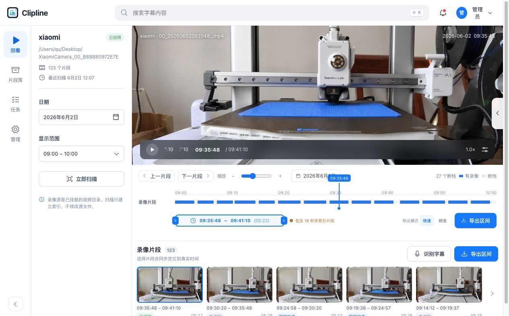
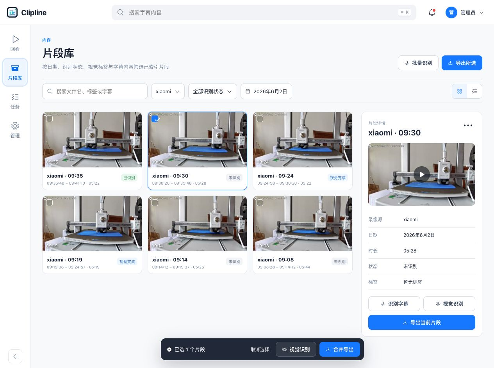
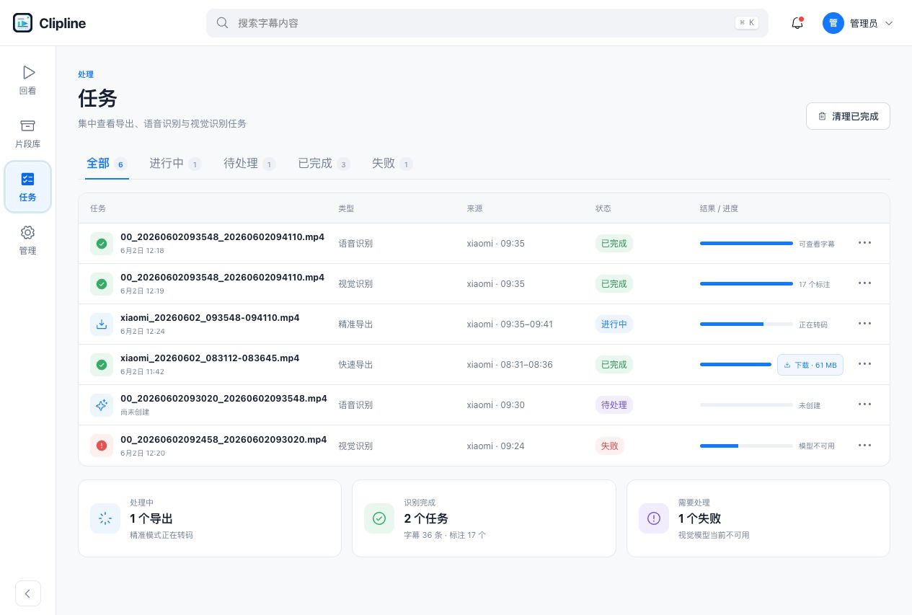
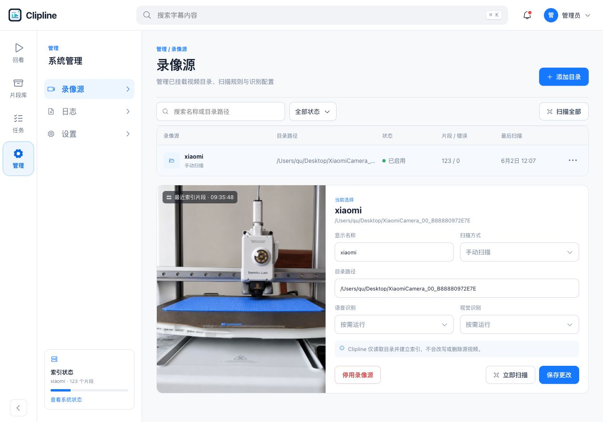
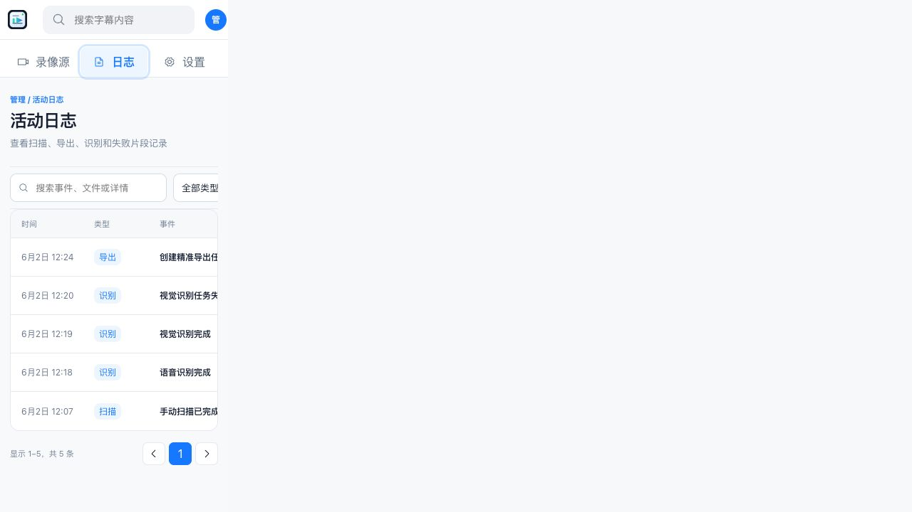
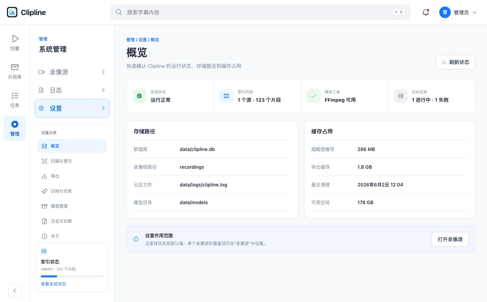
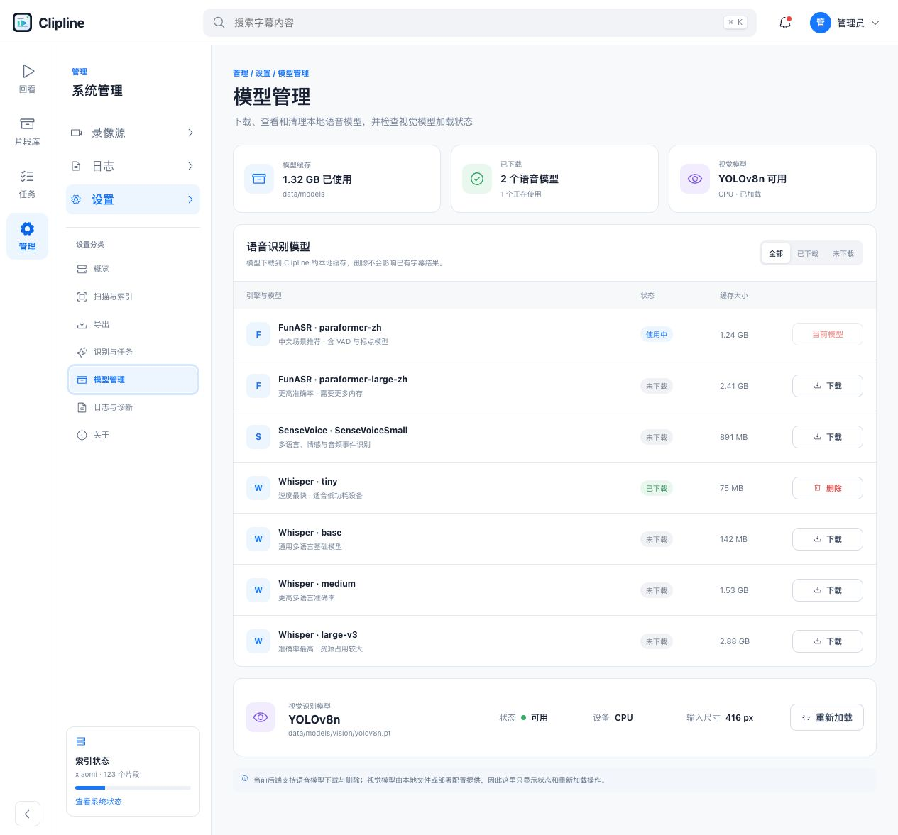
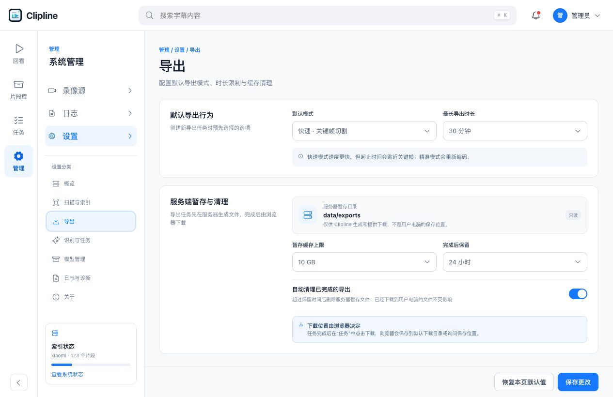

# Full redesign 原型审计

审计日期：2026-07-31
审计目标：确认正式开发所需页面、交互、视觉层级和响应式风险。
用户目标：完全按照 `frontend/prototypes/clipline-full-redesign` 开发。
可访问性目标：键盘可操作、焦点可见、状态不只依赖颜色、窄屏可完成核心任务。

## 总体结论

full redesign 已形成完整、连贯的产品基准，可直接用于正式前端开发。核心信息架构、业务语言和主要状态与真实产品能力一致。

唯一在本轮实机截图中发现的高影响问题是活动日志页宽度异常：内容被压缩在左侧约 306px，右侧大面积空白。正式实现应修复内容宽度和表格滚动边界，但不得改变原型的信息层级与视觉方向。

## Step 1：回看

健康度：可作为开发基准。

- 优点：源上下文、视频、真实时间线、导出区间和片段条形成清晰的核心闭环。
- UX 风险：桌面端信息密度高，开发时必须保持时间线与导出操作不被真实长路径或长文件名挤压。
- 可访问性风险：播放控制、跳转、缩放、时间线拖动和区间把手需要键盘与读屏专项验证。

## Step 2：片段库

健康度：可作为开发基准。

- 优点：筛选、网格、选中详情和底部批量操作层次明确。
- UX 风险：窄屏隐藏右侧详情后，需要保证片段主要操作仍可到达。
- 可访问性风险：卡片选择不能只靠蓝色描边；复选状态和批量条出现需要被辅助技术感知。

## Step 3：任务

健康度：可作为开发基准。

- 优点：三类任务统一展示，状态、进度、结果和失败原因可比较。
- UX 风险：真实文件名可能更长，需要稳定截断并保留完整名称查看方式。
- 可访问性风险：动态进度和完成/失败变化需要 live region 或等效通知。

## Step 4：录像源

健康度：可作为开发基准。

- 优点：目录语义准确，源列表与选中源配置关系清楚。
- UX 风险：真实路径、扫描策略和识别覆盖项必须从 API 精确映射，不可用模拟选项替代。
- 可访问性风险：停用、扫描和保存的状态反馈必须可读，危险操作需要明确确认。

## Step 5：活动日志

健康度：结构正确，布局需修复。

- 优点：日志类型、事件、来源和详情与真实业务一致。
- UX 风险：本轮实机捕获出现内容区错误收缩；正式实现必须让 `.manage-content` 占满剩余宽度。
- 可访问性风险：窄屏表格需要可发现的横向滚动方式，并保持表头与数据关系。

## Step 6：设置概览

健康度：可作为开发基准。

- 优点：健康条、路径、缓存和设置作用范围结构紧凑。
- UX 风险：必须使用真实系统状态和可用性，不得长期显示模拟健康状态。
- 可访问性风险：健康状态需要文字，不得只使用绿点或图标。

## Step 7：模型管理

健康度：可作为开发基准。

- 优点：语音模型状态、大小和动作清晰；视觉模型能力边界准确。
- UX 风险：下载中、下载失败、磁盘不足和当前模型不可删除需要接入真实状态。
- 可访问性风险：下载进度、按钮禁用原因和完成提示需要可被辅助技术感知。

## Step 8：导出设置

健康度：可作为开发基准。

- 优点：服务端暂存路径和浏览器下载位置的语义已经纠正。
- UX 风险：不得重新加入“用户电脑导出目录”输入。
- 可访问性风险：自动清理开关需要明确名称、状态和值变化反馈。

## 最高优先级建议

1. 先重构 App Shell 与导航层级，再迁移页面；旧一级入口不能与新管理层级并存。
2. 先完成回看核心闭环，再实现片段库、任务、管理与设置。
3. 真实数据只替换内容，不改变原型布局和组件位置。
4. 修复活动日志内容宽度和内部滚动边界。
5. 每个页面用相同 viewport、相同业务状态做原型/正式实现并排截图回归。

## 证据限制

- 本轮检查了可见 DOM、核心导航和浏览器截图。
- 尚未完整验证键盘顺序、屏幕阅读器朗读、实际对比度数值、视频字幕轨、下载行为和动态任务通知。
- 原型使用模拟数据；正式实现仍需用真实 API 覆盖加载、空、错误、权限、长文本和失败状态。
